# Wayfarer Abuse Report Tools

Two companion Tampermonkey userscripts that pull Niantic Support's "Reporting Abuse in Wayfarer" ticket emails out of Gmail (or `.eml` files) and extract a best-guess Wayspot name and coordinates from each one. The results end up in a searchable table that you can plot on the Wayfarer map or export as CSV. The second script also keeps a draft list of Wayspots you want to report, and can fill in Niantic's abuse form for you.

| Script | What it does |
|---|---|
| **Wayfarer Map Mods - Abuse Email Importer** | Gets your ticket emails in, via Gmail sync or by dropping `.eml` files |
| **Wayfarer Map Mods - Abuse Reports** | Reads the imported emails, extracts name and coordinates, shows the table, draws map markers and exports CSV. Also keeps your abuse report draft (Marked Wayspots) and auto-fills Niantic's abuse form from it |

Both scripts are add-ons for [Tntnnbltn's wayfarer-map-mods suite][base] and use its native panels and settings. Re-running extraction never requires re-importing your emails.

[base]: https://gitlab.com/Tntnnbltn/wayfarer-map-mods

## Requirements

- A userscript manager (Tampermonkey or compatible).
- **[Tntnnbltn's wayfarer-map-mods suite][base] (v4.0.0 or newer), installed separately on its own.** The scripts add their entry to the suite's side panel, so without it they have nowhere to appear. If you are still using the old `wayfarer-map-mods-base.user.js`, update to the consolidated suite first.
- A Google Cloud OAuth Client ID, **only** if you want Gmail sync. Dropping `.eml` files works with no setup at all.

## Install

1. Install the [wayfarer-map-mods suite](https://gitlab.com/Tntnnbltn/wayfarer-map-mods) first, if you haven't already.
2. Install the [importer](https://raw.githubusercontent.com/Frankmans/AbuseFormImport/refs/heads/main/wayfarer-abuse-email-importer.user.js).
3. Install the [extractor](https://raw.githubusercontent.com/Frankmans/AbuseFormImport/refs/heads/main/wayfarer-abuse-report-extractor.user.js).

The two helper libraries (`opr-email-lib.js` and `wst-storage.js`) are downloaded automatically. There is nothing else to install.

The extractor also runs on Niantic's Help Center (`scopelyexplore.helpshift.com`), but only in a tab that the Wayfarer tab opened for [abuse form auto-fill](#abuse-form-auto-fill). On any other visit to the Help Center it does nothing.

## Setting up Gmail sync (optional)

Only needed if you want automatic sync instead of (or alongside) dropping `.eml` files by hand.

1. Go to the [Google Cloud Console](https://console.cloud.google.com/) and create or pick a project (the name does not matter).

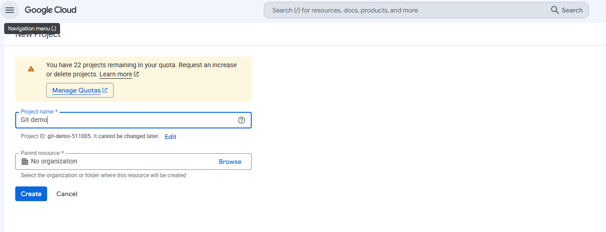

2. **APIs & Services (in the menu at the top left) -> Library**: <ins>enable</ins> the **Gmail API**.

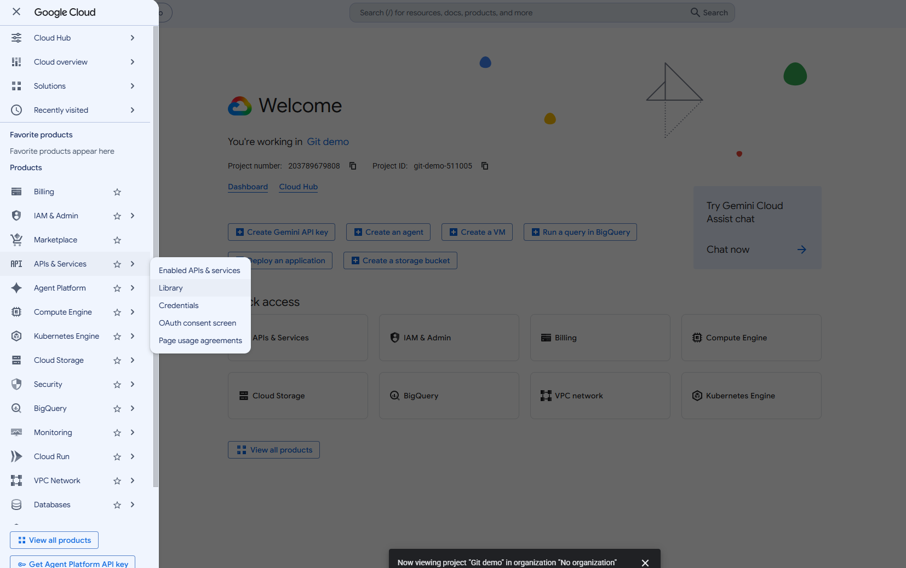
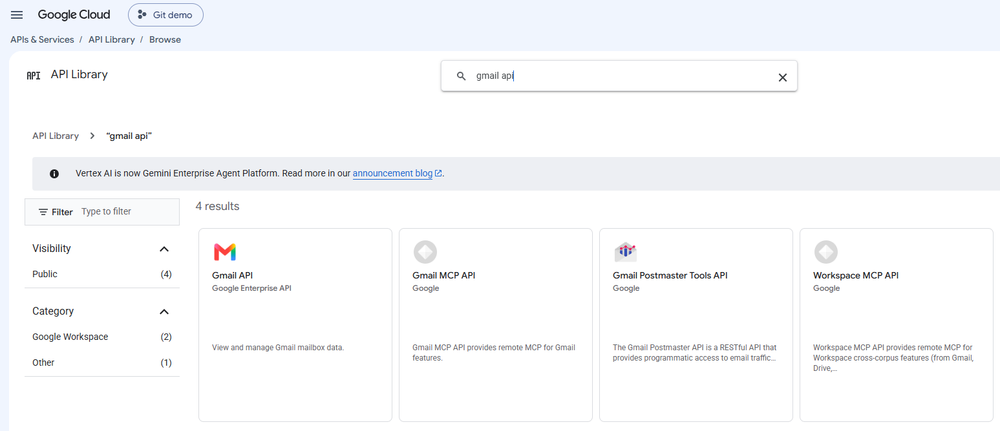
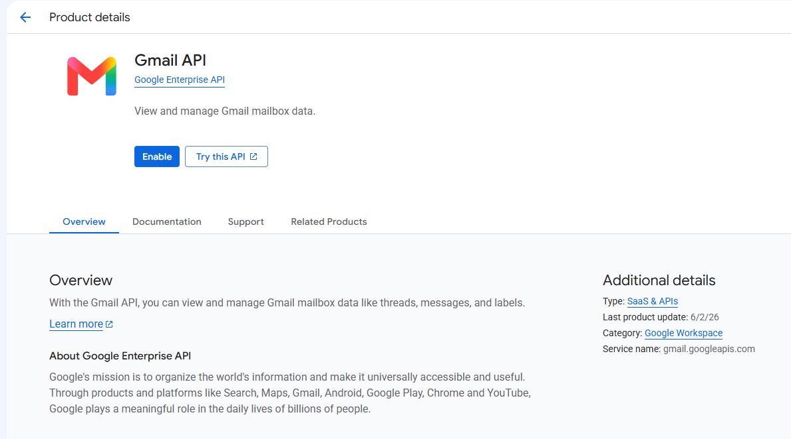

3. **APIs & Services -> OAuth consent screen**: set it up as External.

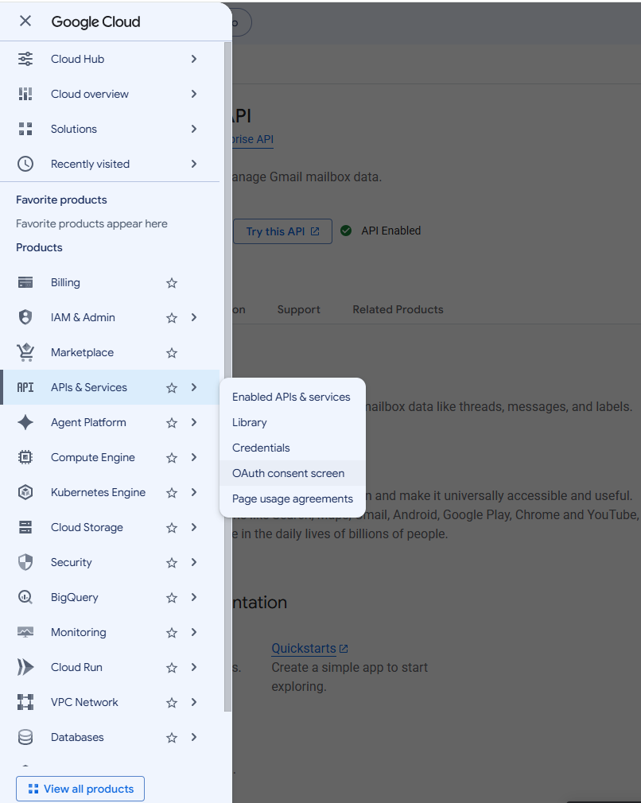
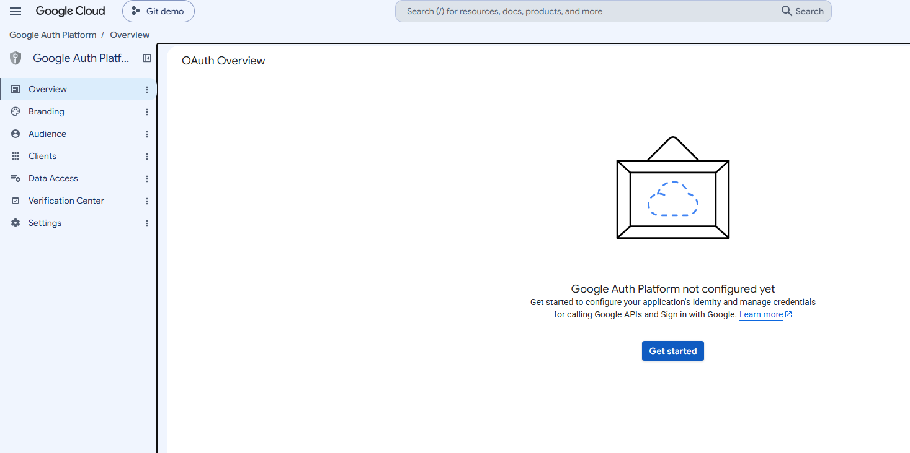
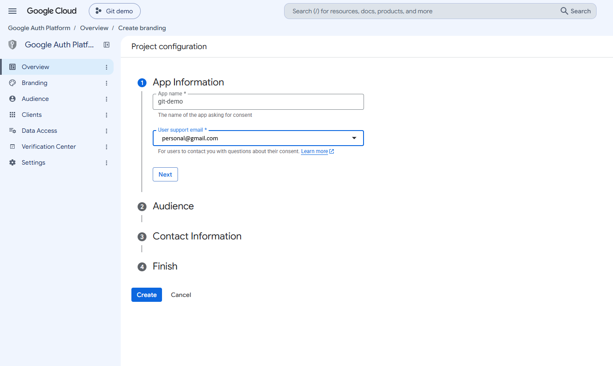
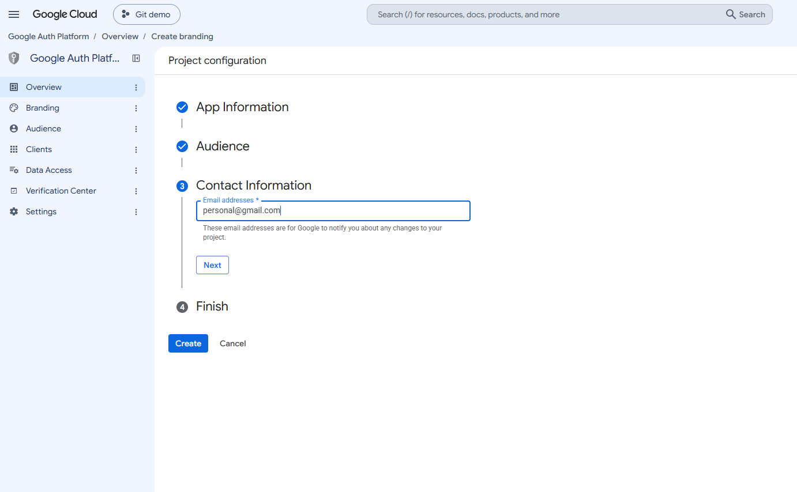
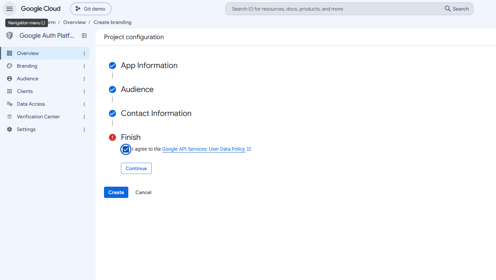

4. While in "Testing" mode (the default, and fine for personal use), add <ins>your own Google account</ins> under **Test users**, or sign-in will be refused. The scope needed is `gmail.readonly`.

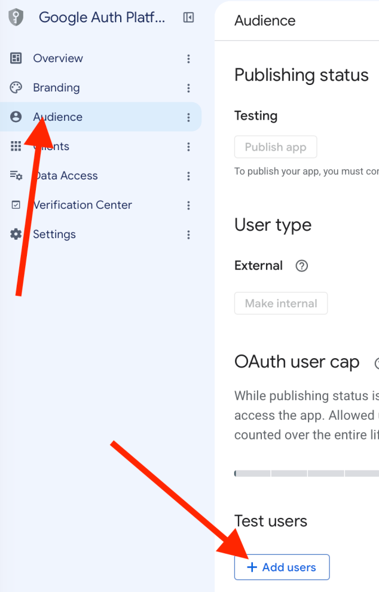

5. **APIs & Services -> Credentials -> Create Credentials -> OAuth client ID**. Application type: **Web application**.

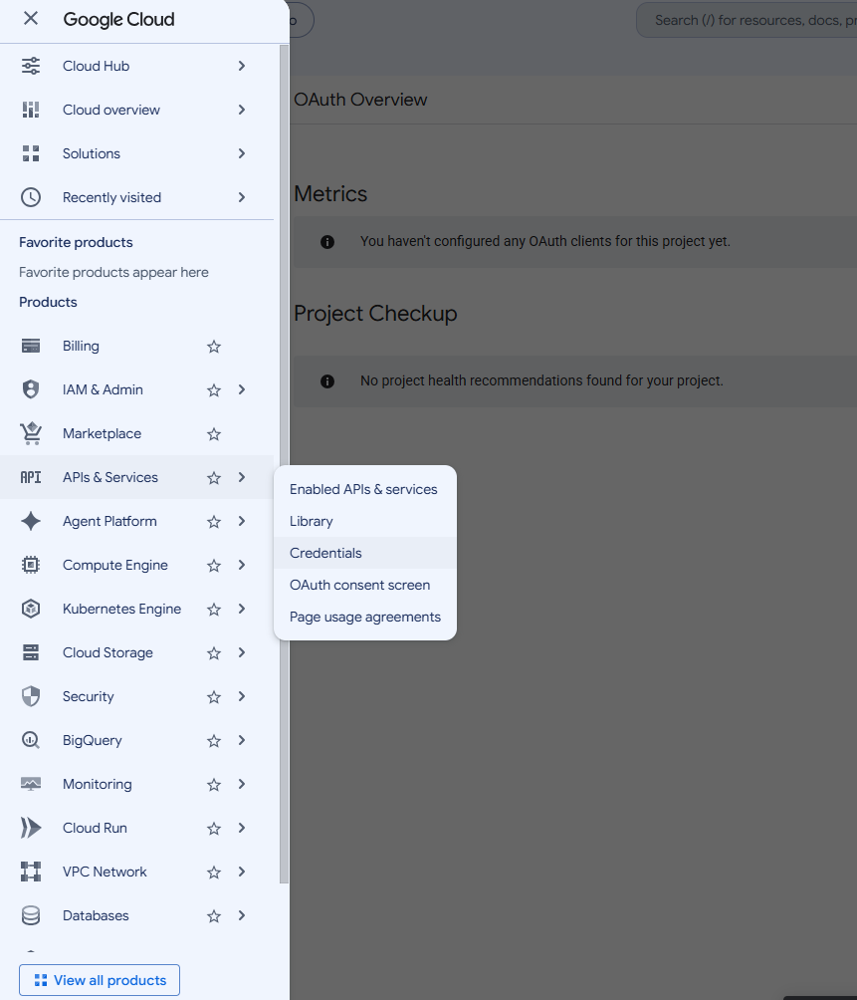
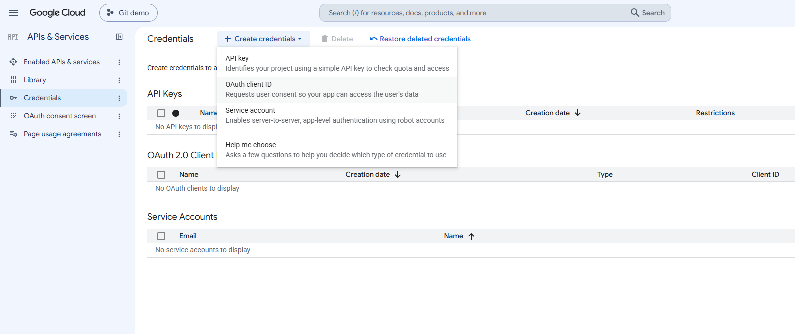

6. Under **Authorized JavaScript origins**, add `https://wayfarer.scopely.com`. No redirect URI is needed. If you set this up back when Wayfarer lived on `wayfarer.nianticlabs.com`, add the new origin to your existing OAuth client rather than creating a new one. The old entry alone will fail silently.

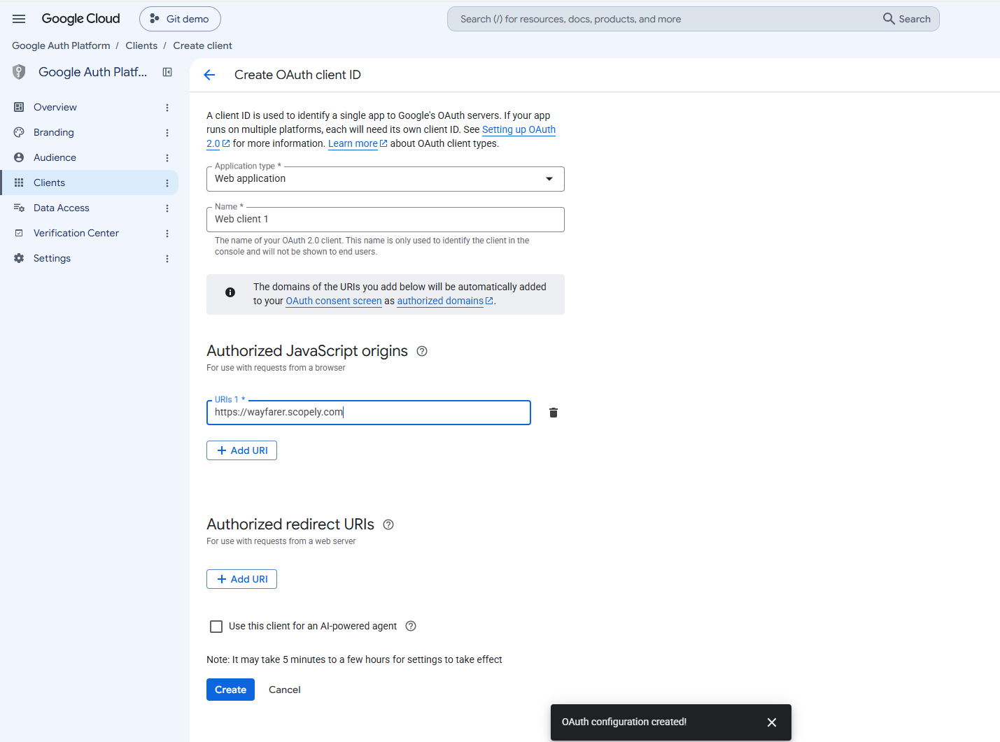

7. Copy the resulting Client ID (it ends in `.apps.googleusercontent.com`) into the **Connect Gmail** field in the importer's panel (click **Abuse Reports** in the side panel, then the envelope icon). It is saved in your browser, so you only paste it once. It is not a secret.

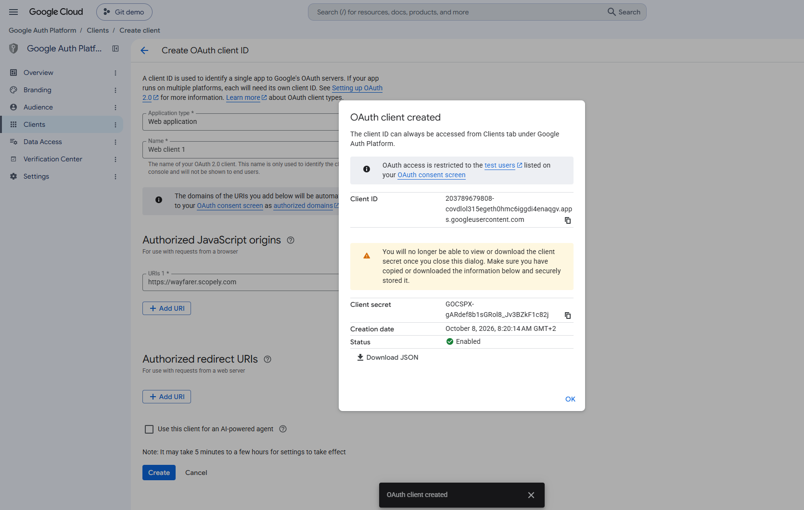
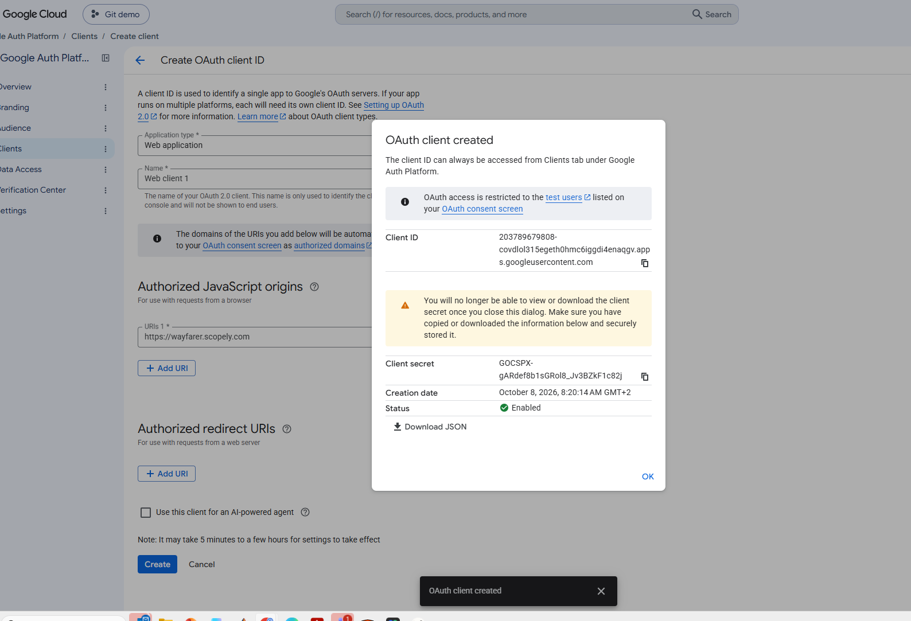

Your access token is never saved. It is requested fresh each time the page loads and kept in memory for that session only.

## Where to find things

The diagrams below are illustrative mockups rather than literal screenshots. They show *where* each control lives, not Wayfarer's exact styling.

**Settings side panel.** Open the suite's side panel and you'll find one entry for both scripts: **Abuse Reports**.

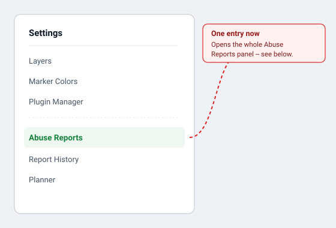

**Inside the Abuse Reports panel.** Three small icons sit next to the summary line, top right: a list icon (opens the **Marked Wayspots** list and the Favorite Users list), an envelope (opens the Email Importer) and a cog (opens Marker Style and the abuse form auto-fill settings).

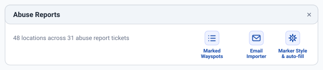

**Showing crosses on the map.** Tick **Abuse Report Crosses** in the native **Layers** menu, the same place every other map layer is toggled.

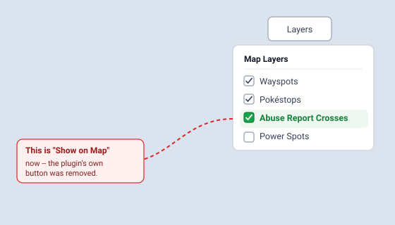

**On the review page.** A small on/off bar sits directly below the map on the review page. It is separate from the Layers menu and the Settings panel. Next to its On/Off button is the same list icon as in the panel header, which opens the Marked Wayspots list.

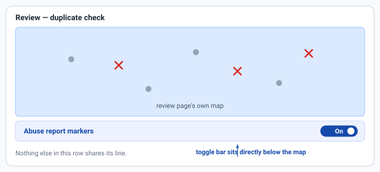

## Using it

1. On `https://wayfarer.scopely.com/new/mapview`, open the suite's side panel and click **Abuse Reports**.
2. Click the envelope icon next to the summary line to open the Email Importer. Either **Sync new emails** (after connecting Gmail) or drop `.eml` files into the dropzone. Turn on auto-sync if you'd like it to check periodically without you opening the panel. Close the importer to return to Abuse Reports.
3. Back in Abuse Reports, click **Scan Imported Emails**. Or tick **Also scan for reports after importing** in the importer's panel to have this happen automatically after every import (see [Scan after import](#scan-after-import)).
4. Review the table. There is one row per reported Wayspot, so a ticket that reports several shows several rows sharing the same `Conversation ID`. Rows missing a name or coordinates are flagged so you can check the raw `Location Details` / `Report Details` columns by hand. Then **Export CSV**, or tick **Abuse Report Crosses** in the Layers menu to see everything plotted on the map.

5. To report Wayspots yourself, mark them as you browse or review, then let the extractor [fill in the abuse form](#abuse-form-auto-fill). Once the ticket email has been imported and scanned, it shows up in the table.

You can sort by clicking the **Conversation** and **Status** headers (click again to flip direction). Status sorts by pipeline stage (Received, then Pending Review, then a settled state) rather than alphabetically, and your chosen sort is remembered.

Both scripts also appear in the suite's **Plugin Manager**, where you can enable or disable them. Disabling one removes its panel and side-panel link completely, and re-enabling rebuilds everything.

## Scan after import

The importer's panel has an **Also scan for reports after importing** checkbox. With it on, any import that adds or updates at least one email (a Gmail sync, a dropped `.eml` file, or a backup restore) immediately scans for reports. New tickets show up in the table and on the map without you opening the Abuse Reports panel, and any [Reported](#wayspots-you-reported-yourself) rows waiting for their ticket are matched up. It works even while the panel is closed, and the setting is saved.

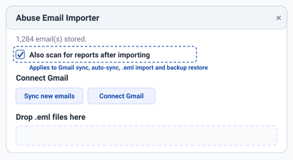

## What counts as an abuse report email

Gmail sync searches two sender addresses: `support@nianticlabs.com` and `support-explore@scopely.com`. These are Niantic Support's "Reporting Abuse in Wayfarer" ticket threads. If tickets stop arriving from one of them, a new sender address may be in use.

Dropped `.eml` files are accepted from any sender. Non-abuse-report emails are screened out when you scan.

## Multiple Wayspots per ticket

A single ticket can report more than one Wayspot, either all at once in the original submission or with more added in a later reply. The extractor picks up all of these:

- The original form's **Provide details of the location(s)** field is split per line, so a report listing several Wayspots (as `Name (lat, lng)`, `Name, lat,lng` or `"Name" at lat,lng`) becomes one entry per line.
- Every other message in the thread is also scanned, both for list-style replies and for coordinates mentioned in ordinary sentences. When a coordinate appears in a longer sentence with no clean label before it, the location is still added, but with the name left blank rather than showing a run-on sentence as a Wayspot name.

Each entry becomes its own row, sharing that ticket's `Conversation ID`. A corrected coordinate mentioned in the original submission's free text (for example "is actually here: ...") is treated as a correction, not as a new location. A Street View or Maps link near a location is kept as that entry's `Comment`. If a reply mixes a genuinely new Wayspot into the same sentence as a correction, it may need a manual check.

## Long-running tickets spanning several emails

An active ticket generates a new email for every reply, and each email only contains a recent window of the conversation. If you've imported more than one email for the same ticket, the extractor merges them into one complete thread before extracting, so a Wayspot mentioned only in an older email is still picked up. For the most complete picture, import every email you have for an active ticket. Auto-sync already does this for you.

## Replies sent from your own mail client

Replying with your mail client's normal reply button (Gmail's, for example) works as well as using Helpshift's own reply link. The extractor detects the quoted history automatically and separates your new reply from it.

## Ticket status

`Ticket Status` is Niantic Support's own reply, classified against three canned closing messages:

| Status | Matches | Meaning |
|---|---|---|
| **Actioned** | *"We have reviewed the report and have taken action on the Wayspots in accordance with our policies."* | Reviewed and acted on. Nothing further to do. |
| **Pending Review** | *"Thank you for your patience as your report is being looked into. We will follow up once we have reviewed the reported Wayspots."* | Still under review. Revisit later. |
| **Denied** | *"We took another look at the Wayspot in question and decided that it does not meet our criteria for removal at this time."* | Reviewed, no action taken. Nothing further to do. |

Two other values can appear:

- **Received**: only the initial automatic acknowledgement, with no human reply yet.
- **Updated**: the newest message is a custom human reply, or a follow-up from the reporter.

Two more badges are not from Niantic at all: a teal **Reported** for [Wayspots you reported yourself](#wayspots-you-reported-yourself) that have no ticket yet, and a purple **Imported** for CSV rows.

Only the newest message in the thread is checked. If the reporter sends a follow-up (say, a "thanks!") *after* the real decision, the status reads **Updated** again even though a decision was made earlier. This is expected behavior.

Statuses show as color-coded badges, and searching for a status name (e.g. "pending") matches them. Wayspots brought in with **Import CSV** get their own purple **Imported** badge, and ones you cleared from your draft after submitting the abuse form get a teal **Reported** badge.

## Flagging nearby duplicate reports

Rows get a ⚠️ and a subtle highlight when their coordinates fall within 20 m of a location from a **different** ticket, meaning the same spot was reported more than once independently. Click the ⚠️ for a popover listing which tickets and how far away. Each entry is clickable and jumps the map to that match. The same detail is in the CSV's `Nearby Tickets` column.

Locations within one ticket are never flagged against each other.

## Starring rows & Last Response

- Click a row's ★ cell to star it. Click the ★ column header to sort (ascending shows starred rows first). Starred rows stay starred when you re-scan.
- The **Last Response** column shows the newest message across every email imported for that ticket. It is sortable, and rows without a parseable date always sort last. In the CSV it appears as `Last Response (UTC)`, in ISO 8601 format.

## Editing and deleting a row

Every row ends with a pencil (✎). Rows are locked by default. Click the pencil to unlock that row, which turns its cells into inputs: **Conversation**, **Wayspot Name** (with a **Note** field underneath), **Coordinates** (`lat, lng`, or blank for none), **Status** (dropdown) and **Last Response** (date/time picker).

The table keeps its scroll position while you edit, star or delete rows, so you stay where you were in the list. Changing the page, the sort order or the search starts from the top again.

While a row is unlocked, three buttons replace the pencil:

- **✓** saves your changes (**Enter** does the same).
- **↩** discards your changes and locks the row again (**Esc** does the same).
- **✕** deletes this one row (a single Wayspot, not the whole ticket), after a confirmation. Other rows of the same ticket are kept.

Only one row is editable at a time. Opening another discards the first one's unsaved changes. Coordinates that aren't a valid `lat, lng` pair are rejected and the field is highlighted.

Saved edits update the table, map crosses, nearby-ticket flags, search and CSV export straight away. An edited row shows a small blue dot next to its pencil and is kept when you re-scan, even if you changed its coordinates.

A deleted entry disappears from the table, the map and the CSV export immediately, and stays gone when you re-scan. A row you imported from a CSV, or a **Reported** row that is still waiting for its ticket, can't be recovered once deleted, because it has no source email. **Clear Extracted Data** wipes everything, including edited rows, and also brings manually deleted entries back the next time you scan. Its confirmation warns you when CSV-imported or Reported rows are among them, since a re-scan can't bring those back.

## Importing locations from elsewhere (CSV)

**Import CSV** (next to Export CSV) is for locations that didn't come from a scanned email, such as a known problem spot from another source. It is not for re-importing this tool's own export.

Only a latitude/longitude column pair is required. Common header spellings are accepted (`Lat`/`Latitude`, `Lng`/`Long`/`Longitude`, case-insensitive). `Name`, `Comment` and `Conversation ID` are optional.

```
Latitude,Longitude,Name,Comment,Conversation ID
1.234567,1.234567,Example Wayspot,Optional note,12345
```

Imported rows appear in the table and on the map like any other, with a purple **Imported** badge and their own **Imported color** markers. They survive re-scans. Since they have no source email, **Clear Extracted Data** removes them for good, and its confirmation message warns you about this.

## Searching

The search box above the table filters on name, conversation ID, comment, issue type, both raw text fields and the source filename/email ID. A leading `#` is ignored, so `#12345` finds the same reports as `12345`. A total under the table reads, for example, `48 reported Wayspots`, or `5 of 48 reported Wayspots` while a search is filtering it.

Search only changes what the table displays. **Export CSV**, the map crosses and the summary counts always reflect everything.

## Large histories

The table shows 200 rows at a time, with **Prev**/**Next** controls once you have more. This keeps things fast even with thousands of rows.

## Plotting on the map

Tick **Abuse Report Crosses** in the **Layers** menu to plot every extracted location on the Wayfarer map.

- **Clustering.** Nearby locations merge into a single numbered badge when zoomed out and split into individual X markers as you zoom in.
- **Popups.** Click a marker for its name, coordinates, comment, and ticket ID with the date of the ticket's last interaction. Click a cluster to zoom in on it. If a cluster's reports all share the same coordinates, clicking it at maximum zoom opens a popup listing every ticket in it.
- **Remembered state.** Your on/off choice is remembered and re-applied on the next page load. Markers stay in sync after every scan or clear.
- **Where it works.** On both the general map view and the zoomed-in submit/edit view, switching between them automatically.
- **Jumping from the table.** Click any table row with coordinates to jump the map there and open the same popup. The panel closes so you can see the map. Untick **Close this panel when a row jumps the map to its location** (below the search box) to keep it open while you click through several rows.

### Live Wayspot annotation

Independent of the crosses layer: click any Wayspot on the map, and if it is within 20 m of one of your extracted locations, its details card in the side panel gets a `#<ticket>` line just above the status badge. Several matching tickets are shown comma-separated. The line ends with the date of the most recent interaction (short date, with the full date and time on hover).

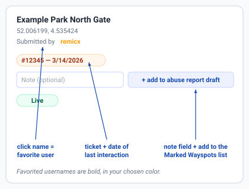

### On the review page

Crosses also plot on `https://wayfarer.scopely.com/new/review`, on the duplicate-check map and the edit-location/edit-info maps. This lets you see nearby prior abuse reports while reviewing a nomination.

The review page has its own small on/off bar below the map (on by default), separate from the Layers menu. Review-page markers are always click-through, regardless of the "Clickable markers" setting, so they never get in the way of the review UI underneath.

### Marker Style

Click the cog icon in the Abuse Reports panel header to open Marker Style. It covers:

- **Color**, **size** and **fill opacity** of the map markers, plus ring color, width and opacity for cluster badges. The X shape of individual reports is fixed, so only its color and size are adjustable.
- **On the review maps** the crosses (abuse reports and your abuse report draft) are always 3px larger than **Cross size**, following it as you change it, and are drawn on top of the Wayspot markers there. They are click-through, so a click still reaches the Wayspot underneath.
- **Imported color** for CSV-imported locations. It follows **Color** until you pick one of your own. **Same as email color** or **Reset to default** returns it to following. A cluster only takes the imported color when *every* location in it is imported.
- **Marked Wayspot color** and **Favorite user color** (see below).
- **Clickable markers (mapview/submit only)**: turn this off to let clicks pass through to whatever is underneath instead of opening this plugin's popup.

Changes apply live to markers already on the map.

This window also holds the [Abuse form auto-fill](#settings-for-the-auto-fill) settings, in a section of their own below the marker options.

## Resizing the panel

When Wayfarer Map Mods' **Make modals resizeable** preference is on, you can drag the corner of the Abuse Reports panel to resize it, and the table follows: make the panel taller to see more rows at once, or shorter to see fewer without the whole panel scrolling. The table shows at most the rows that fit, with a small minimum, and goes back to its normal height if the panel isn't resized.

## Resizing table columns

Drag the border between two column headers to resize them. A drag trades width between the two neighboring columns, so the table always stays full-width, and no column can be squeezed too small. Widths are remembered across sessions and included in **Settings > Backups**.

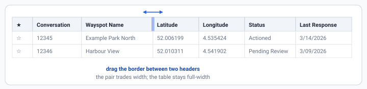

## Marked Wayspots

Your abuse report draft: a list of Wayspots you are about to report yourself. It is separate from the ticket table, which covers reports already filed, and it is what the [abuse form auto-fill](#abuse-form-auto-fill) works from. Nothing is sent from the list itself.

**Adding.** Click a Wayspot on the map. In its details card in the side panel, type an optional note (up to 1000 characters) and click the flag-with-a-plus button next to the note field (tooltip: *Add this Wayspot to your abuse report draft*). It flashes a check mark. If the Wayspot is already on the list (matched by coordinates, not name), its note is overwritten with whatever is in the field, including being cleared if the field is empty. A Wayspot's name is only ever filled in or improved this way, never blanked. An "Untitled location" shows as "(unnamed)". The same note field and button also appear on the review page and in review map info windows.

**The list.** Open it with the list icon in the Abuse Reports panel header, or, on the review page, with the list icon in the bar under the map (titled **Abuse Report Draft - Marked Wayspots**):

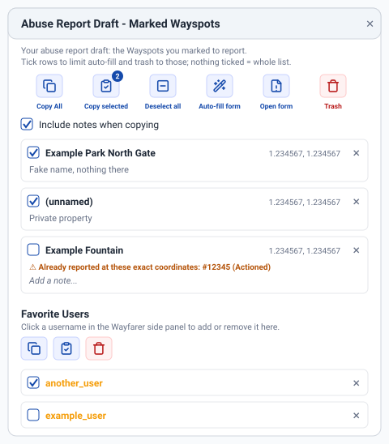

The buttons above the list are icons. Hover one for its tooltip, which also shows how many rows it will act on:

- **Copy All** puts one line per entry on the clipboard as `Name, lat, lng (note)`, with coordinates to six decimals and the note only when there is one.
- **Copy selected** copies only the ticked rows, in list order and in the same format. It shows the number ticked and stays disabled until something is ticked.
- **Deselect all** unticks every row at once without redrawing the list, so your scroll position and any note you are editing stay as they are.
- **Auto-fill abuse form** (the wand) opens Niantic's abuse form and fills it in, see [Abuse form auto-fill](#abuse-form-auto-fill).
- **Open the abuse form** opens Niantic's "Reporting Abuse in Wayfarer" article in a new tab, without filling anything in.
- **Trash** removes the ticked rows after a confirmation, or the whole list when nothing is ticked.

Ticking rows works the same everywhere: **with one or more rows ticked, Copy selected, the wand and the trash button act on just those rows. With nothing ticked, the wand and the trash button act on the whole list** (Copy All always copies everything). Ticks are not saved and reset when the window is reopened.

- **Include notes when copying** (on by default) removes the notes, giving plain `Name, lat, lng` lines. It is saved, and applies to Copy All, Copy selected, the auto-fill and the copy icon on the review page.
- **Click a row** to jump the map there and open a popup with its name, coordinates and note. On the review page it just pans the review map to that Wayspot, where the draft marker is. Click a row's **note** to edit it in place (click outside the box to save), and click **×** to remove just that entry.

**Already reported flag.** A row whose coordinates are *exactly* the same as a row in your abuse reports list (same latitude and longitude to six decimals) gets an amber line, for example `⚠ Already reported at these exact coordinates: #12345 (Actioned)`. A Wayspot you reported yourself that is still waiting for its ticket shows as `reported <date>`. Nearby locations are deliberately not flagged here, unlike the 20 m [duplicate check](#flagging-nearby-duplicate-reports) in the table. The flags refresh by themselves after a scan.

**On the map.**

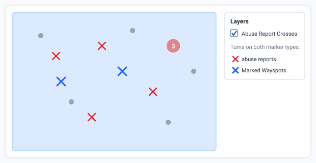

Every entry also gets a cross marker on the map view, in its own color (default blue, changed with **Marked Wayspot color** in Marker Style) and sized by the same **Cross size** slider. Click one for its details. These markers follow the **Abuse Report Crosses** checkbox in the Layers menu.

The same markers also show on the review maps, so a Wayspot already on your draft is visible while you review next to it. There they are drawn like the report crosses on those maps (3px larger than on the map view, on top of the Wayspot markers, click-through) and follow the **Abuse report markers** toggle under the map instead of the Layers menu.

A total under the list (for example `5 draft report Wayspots`) shows how many Wayspots are on it.

The list is saved with the suite's settings, so it is included in **Settings > Backups**.

## Abuse form auto-fill

The wand button in the Marked Wayspots list opens Niantic's "Reporting Abuse in Wayfarer" Help Center article in a new tab and fills the form in for you. The Wayfarer tab hands the data to the Help Center tab directly, so keep the Wayfarer tab open until the form is filled in.

**What happens, step by step.**

1. Click the wand. A small status message appears at the bottom left of the new tab (click it to dismiss).
2. The tab clicks the article's **Report an abuse** button for you. If it can't find the button, it says so and you click it yourself. The form is still filled in afterwards.
3. On the first step, your **name** and **email** are entered, and **Next** is pressed for you when both were filled in.
4. On the report step, the **location field** gets your list (the same text Copy All would give, so it respects *Include notes when copying*, unless the [list-in-report-details option](#settings-for-the-auto-fill) is on). The **report details**, the **abuser(s)** and the **issue type** are filled from your settings.
5. The page scrolls so the **Submit** button is near the bottom of the window.

**What it never does.** It never presses Submit. You check everything, then submit it yourself. It only fills fields that are still empty, so anything you typed is left alone, and a setting you left empty is left for you to fill in (the status message lists what is still yours). It keeps waiting for up to five minutes, so you can click through the form's steps at your own pace.

**Which Wayspots.** With rows ticked in the list, only those are sent. With nothing ticked, the whole list is sent. The status message says how many Wayspots went into the location field.

<a id="settings-for-the-auto-fill"></a>
**Settings for the auto-fill.** Click the cog in the Abuse Reports panel header and scroll to **Abuse form auto-fill**:

| Setting | What it does |
|---|---|
| **Name**, **Email** | Entered on the form's first step. Leave empty to fill them in yourself. |
| **Issue type** | Chosen in the form's *What issue are you reporting?* menu. Defaults to *Fake Nominations or criteria issues*. Pick *Don't select* to choose it yourself. |
| **Report details** | Default text for *Abuse report details*. Empty means you write it. |
| **Abuser(s)** | Default text for *Details of the abuser(s)*. Empty means you write it. |
| **Also put the Wayspot list, with notes, in the report details** | Off by default. When on, the **location field** gets the list *without* notes (whatever *Include notes when copying* says) and the **report details** get the list *with* notes instead of your default report details text, which is not used while this is on. Applies to the list's wand and to the review page's wand. |
| **After the form is submitted** | Off by default. See below. |

These are saved with the suite's settings, so they are included in **Settings > Backups**. That includes your name and email, so keep backup files private.

**After the form is submitted (optional).** With this on, the Help Center tab watches for the form being submitted (your click on **Submit**, followed by the form disappearing or the confirmation text showing up). A click that is rejected, for example because a required field is empty, is ignored and the tab stays open. Once the submission went through, the tab closes by itself after 1.5 seconds and the Marked Wayspots list asks whether to clear the Wayspots that were just sent (the list opens for the question if it was closed):

- **Clear them** removes exactly those Wayspots from the draft, and nothing you marked since. They move to your abuse reports list as **Reported** rows, see below.
- **Keep them** leaves the draft as it is.

This question only follows the wand in the Marked Wayspots list. The review page's own wand (see [Abuse helper on the review page](#abuse-helper-on-the-review-page)) sends a single Wayspot and has no draft to clear.

### Wayspots you reported yourself

**Clear them** is the only action that creates these rows. Removing entries with the **×**, the trash button or **Clear All** just deletes them.

Each cleared Wayspot appears in the main table with a teal **Reported** badge, the report date in the **Last Response** column, and the name, coordinates and note it had. It has no ticket number yet. These rows behave like any other: you can star, edit or delete them, they are plotted on the map, and they take part in the nearby-duplicate flags and the draft list's [already reported flag](#marked-wayspots).

Every scan (including the automatic one after an import) looks for the ticket behind each Reported row: a ticket location within 20 m whose newest message is not older than the report (with a day of slack, because ticket dates carry no time zone). When it finds one, the Reported row is replaced by that ticket's own row, and a star carries over. If several tickets qualify, the earliest one wins. Rows without a match yet stay until a later scan. Reporting the same coordinates again updates the existing Reported row instead of adding a second one.

Reported rows live in the extracted reports database and have no source email, so **Clear Extracted Data** removes them for good, just like CSV-imported rows.

## Favorite users

When Wayfarer shows a **Submitted by <username>** line in the side panel (for example while reviewing a nomination), click the username to mark that user as a favorite, and click again to remove them. A favorite turns bold in a color you choose with **Favorite user color** in Marker Style (default amber; **Reset to default** restores it). Names are matched ignoring case and surrounding spaces.

Favorites are listed in a **Favorite Users** section of the same window as the Marked Wayspots list, each with an **×** to remove it and a **Clear All** button (with confirmation). A total under the list (for example `3 favorite users`) shows how many favorites there are.

- **Notes.** Each favorite has its own note (up to 1000 characters). Click **Click to add a note…**, type, and click outside the box to save. Notes appear in the list only and are never part of what you copy.
- **Copying usernames.** Every row has a checkbox. **Copy All** copies every username, one per line. **Copy Selected** (which shows a count, e.g. *Copy Selected (3)*, and stays disabled until something is ticked) copies only the ticked ones. The button briefly reads **Copied!** (or **Copy failed**). Ticks aren't saved and reset when the window is reopened or you **Clear All**.

Favorites are saved with the suite's settings and included in **Settings > Backups**.

## Abuse helper on the review page

This replaces the standalone **Wayfarer Abuse Text Formatter** script. Uninstall that script once this one is running, or you'll see both. On `https://wayfarer.scopely.com/new/review`, every review candidate (new Wayspot, photo or edit) gets a single row: a **note field**, followed by four icon buttons (hover for the tooltip):

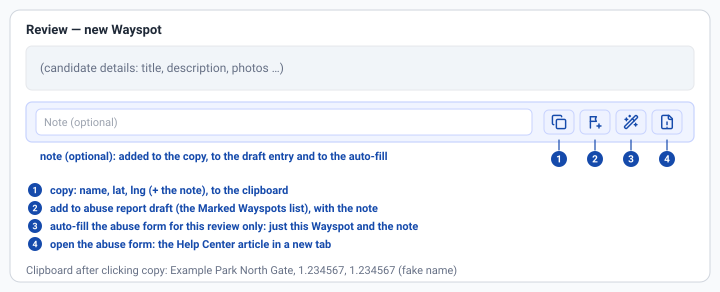

- **Copy** copies `Name, lat, lng` in the same format as the Marked Wayspots list's Copy All, with the note from the field appended when **Include notes when copying** is on. The icon briefly turns into a check mark to confirm.
- **Add to abuse report draft** (flag with a plus) adds the candidate, with the note, to your Marked Wayspots list. If it is already there, the note is overwritten.
- **Auto-fill the abuse form for this review only** (wand) opens the abuse form and fills it with just this Wayspot and the note beside it. Nothing is added to your draft list. The note is always included here, whatever the *Include notes when copying* checkbox says, and one typed or changed while the form is loading is picked up too. Name, email and the other [settings](#settings-for-the-auto-fill) are used as usual. If the browser blocks the new tab, the icon shows a cross.
- **Open the abuse form** (page with an exclamation mark) opens the Help Center article in a new tab, so your review in progress isn't lost.

The row only appears while the plugin is enabled in the Plugin Manager.

## Abuse draft in review map info windows

When you click a nearby Wayspot on a review's map (the duplicate-check map, or the edit-location, edit-info and photo maps), the info window that opens gets the same **Note (optional)** field and **+ add to abuse report draft** button the side panel and the review-page row have. Use it when you spot an abusive or fake Wayspot while reviewing something else. It goes straight onto your Marked Wayspots list, with the same behavior as everywhere else: adding a Wayspot that's already on the list updates its note instead of creating a second entry.

- **Turning it off.** Switch off the **Abuse report markers** toggle under the review map, which hides the report markers, your draft markers and these controls together. Or untick **Show add-to-draft controls in review map info windows** in the Marker Style settings (the cog icon in the Abuse Reports panel header) to hide only the controls. Either applies immediately, including to a window that is already open. The note-and-add row for the nomination itself (above the review card) is separate and stays as it is.
- **Windows that don't get the controls.** The controls need to know exactly which Wayspot a window is about. Wayfarer's own windows are matched against the nearby Wayspots in the review itself, which always works unless two of them share the same title and photo. Wayfarer Map Mods' own windows (the ones with a **Mark as duplicate** button, and all edit and photo reviews) are read from their map link, so they only get the controls while **Display map shortcuts on info window of duplicates** is on in Wayfarer Map Mods' Review Map Enhancements settings. When a window can't be identified it gets no controls, rather than a guess.
- **Re-opening.** The controls are rebuilt whenever a window shows a different Wayspot, so a note typed for one Wayspot never carries over to the next.

## CSV columns

`Starred`, `Conversation ID`, `Ticket Status`, `Last Response (UTC)`, `Wayspot Name (best guess)`, `Latitude`, `Longitude`, `Comment`, `Nearby Tickets (<20m, other tickets)`, `Issue Type`, `Location Details (raw)`, `Report Details (raw)`, `Source Email ID`, `Source Filename`.

- `Comment` holds a Street View / Maps link found near that specific location. It shows as a hover-for-full-text 💬 in the table.
- `Nearby Tickets` lists other tickets with a location within 20 m of this row.
- `Source Email ID` / `Source Filename` list every email that contributed to the row (semicolon-separated).
- `Issue Type`, `Location Details (raw)` and `Report Details (raw)` are written only on a ticket's **first** row and left blank on its other rows, since that text belongs to the ticket rather than each location. Use `Conversation ID` to group rows back together. `Comment` is written on every row.
- The two "(raw)" columns let you sanity-check or hand-correct a bad guess in a spreadsheet.
- A hand-edited row exports its edited values, not the original scanned ones.

## Data storage & privacy

Everything is stored in your own browser (IndexedDB and the suite's settings) and never leaves it, apart from the Gmail API calls you make yourself and the abuse form auto-fill. The auto-fill passes your list, name and email from the Wayfarer tab to the Help Center tab it opened (the two tabs talk to each other directly, and only to those exact origins), and the form is submitted by you, to Niantic.

- **Imported emails** are kept in one local database.
- **Extracted reports** are kept in a second, separate local database. This includes CSV-imported rows and **Reported** rows.
- **Your preferences and lists** (Marker Style settings including the Marked Wayspot and Favorite user colors, the close-panel-on-jump and copy-with-notes checkboxes, the scan-after-import checkbox, column widths, the abuse form auto-fill settings with your name and email, the Marked Wayspots list and the Favorite Users list) live in the suite's settings, so they are included in the suite's **Settings > Backups** export/import.

Both the importer and the extractor panels have **Export backup JSON**, **Import backup JSON** and **Clear** buttons. Clearing extracted data does not touch your imported emails, so you can re-scan at any time to rebuild it.

## Known limitations

- Name and coordinate extraction is **best-effort**. It has been refined against many real tickets but is not derived from a formal specification. Treat low-confidence rows, especially anything unusual, as needing a manual check before you rely on them.
- A location's *name* is only kept when a short, clean label was found. Otherwise the location is added with a blank name rather than a guess.
- A reply that mixes a new Wayspot into the same sentence as a correction may need a manual check.
- The abuse form auto-fill finds the form's fields by their labels, and the issue type by driving the dropdown like a person would. If Niantic changes the form, a field may be left for you to fill in (the status message says which), and the issue type may be selected but flagged as *could not confirm it, please check*. **Copy All** always works as the fallback.
- A **Reported** row is only matched to its ticket by coordinates and date. If that ticket has not been imported and scanned yet, the row stays as it is.

## Troubleshooting

- **The scripts don't appear anywhere.** Make sure the wayfarer-map-mods suite (v4.0.0 or newer) is installed and enabled, and that you are on a `https://wayfarer.scopely.com` page.
- **A script works but isn't listed under External plugins in the Plugin Manager.** Update to the latest version of both scripts.
- **Gmail sign-in is refused.** Check that your Google account is listed under **Test users** and that `https://wayfarer.scopely.com` is in the OAuth client's **Authorized JavaScript origins**.
- **The wand opens a tab but nothing gets filled in.** The Help Center tab only gets its data from the Wayfarer tab that opened it, so keep that tab open and don't navigate it away. If the Help Center tab says the Wayfarer tab did not answer, reload the Wayfarer tab (it needs a current version of the extractor) and click the wand again.
- **The wand shows a cross.** The browser blocked the new tab. Allow pop-ups for `wayfarer.scopely.com`, then click again.
- **Name and email are left empty.** Fill them in under the cog's **Abuse form auto-fill** section. Empty settings are left for you on purpose.
- **The form was filled in the wrong place or not at all.** Use **Copy All** (or **Copy selected**) in the Marked Wayspots list and paste into the form's location field yourself, and check the browser console for the field list the script logs.
- **The tab didn't close after submitting.** The option is off by default (see [After the form is submitted](#abuse-form-auto-fill)). Browsers may also refuse to close a tab they don't consider script-opened, in which case the status message says you can close it yourself.
- **Tickets stopped arriving in Gmail sync.** Check whether tickets are now coming from a new sender address (see [What counts as an abuse report email](#what-counts-as-an-abuse-report-email)).

## Credits

The email parsing and classification library is a vanilla-JS port of the `src/email` module from [bilde2910/OPR-Tools](https://github.com/bilde2910/OPR-Tools). The scripts build on [Tntnnbltn's wayfarer-map-mods suite][base].
